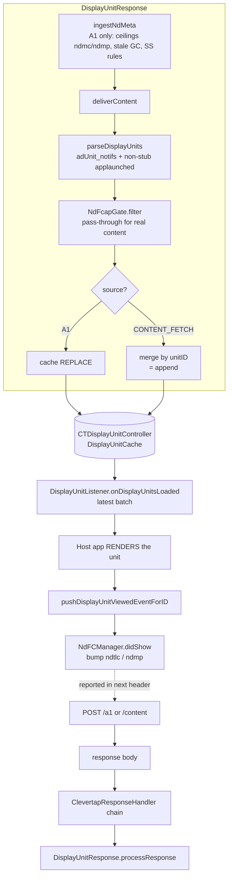

# Native Display: Serving, Frequency Caps, and Content-Fetch Arbitration

This document is the Native Display (Display Units) counterpart to
[In-App Notifications: Frequency Caps, Staleness/Meta, and Serving/Rendering](InAppFrequencyCapsAndServing.md).
It explains how a display unit travels from the network response to the host app, how frequency caps
are enforced for Native Display, and how **content-fetch arbitration** (recommendation-personalized
units) avoids wiping the delivered set.

For the dashboard/integration view of frequency capping — what you can cap and the one API your app
must call — see [Frequency Capping — In-App & Native Display](NativeDisplayFrequencyCaps.md).

All paths are relative to `clevertap-core/src/main/java/com/clevertap/android/sdk/`. Line numbers
drift; treat names as the anchors.

The one structural fact that shapes everything below: **the SDK does not render a display unit.** It
parses, caps, caches, and hands the host a list through a callback — the host draws it. Contrast
in-app, where the SDK owns an on-device display queue and the render pipeline.

---

## 0. Architecture at a glance



Two things make Native Display different from in-app:

1. **Delivery is a callback, not a render.** `DisplayUnitListener.onDisplayUnitsLoaded(units)` hands
   the host the current set; the host decides when and how to draw each unit. There is no
   single-slot display queue and no "one at a time".
2. **Impression accounting is app-driven.** Because the SDK is not in the render path, it only learns
   a unit was shown when the app calls `pushDisplayUnitViewedEventForID(unitID)`. That call is what
   advances the counters the caps run on.

---

## 1. Families: server-side + legacy only (no client-side)

Native Display has **no client-side (CS) mode** — there is no in-action evaluation and no
delivery-mode switching. Only two families exist:

- **Server-side (advanced-rule) campaigns** — the rules (not the content) arrive in
  `adUnit_notifs_ss`; the SDK evaluates them on the event stream and votes eligible ones into
  `adUnit_eval`.
- **Legacy campaigns / journey nodes** — classic per-campaign caps (`efc`/`tlc`/`tdc`/`mdc`).

ND keeps **fully separate per-channel state** from in-app — its own counters, impression windows,
triggers, and metadata stores. It never shares files or in-memory state with in-app.

---

## 2. Frequency caps — where they are enforced

| Cap | Enforced by | Notes |
|---|---|---|
| Advanced `frequencyLimits` / `occurrenceLimits` / `whenTriggers` | **SDK at eval** (`adUnit_eval` vote) | the SDK evaluates `adUnit_notifs_ss` on events and votes eligible campaigns |
| Per-target daily / lifetime (`efc` / `tdc` / `tlc`) | **Server** (legacy path) | SDK does not re-check at delivery |
| Account daily ceiling (`ndmp`) | **Server** (regular events) / **SDK** budget trim (App-Launched) | absent ⇒ unlimited |
| Session caps | **SDK** | the session-scoped part of the gate |

**The delivery gate is pass-through for real content — by design.** `NdFcapGate.filter` runs inside
`parseDisplayUnits`, but the delivered payload carries no frequency-cap keys (advanced rules live in
`adUnit_notifs_ss`; legacy caps are server-side), so its `canShow` read resolves to "uncapped". This
is intentional, not a gap: unlike in-app — which has an unpredictable eval→render gap and must
re-verify caps at the last moment — ND is callback-only, so a delivery-time re-check buys nothing.

**Counting is what matters.** `NdFCManager.didShow`, driven by the app's viewed event, bumps the
SDK-owned counters (`ndtlc` per-target, `ndmp` global). The server reads those verbatim and never
derives its own count — so accurate impression reporting from the app is what makes caps work.
`excludeGlobalFCaps` units are *not counted*; `efc` units still *count* but bypass the shared caps.

ND cap state lives in its own SharedPreferences namespaces: `nd_counts_per_target` (today+lifetime
counts, global ceilings), `nd_impressions` (whenLimits time windows), `nd_triggers_per_target`
(onEvery/onExactly), and `adUnit:` (the SS metadata bundle + pending eval/suppressed lists).

---

## 3. Response handling & routing

`response/DisplayUnitResponse.kt` processes the ND keys, branching on
[`CTResponseSource`](InAppFrequencyCapsAndServing.md#51-response-source-ctresponsesource):

- `processResponse(..., responseContext)` reads `responseContext.source`.
- **`ingestNdMeta` runs on `A1` only** (`source != CONTENT_FETCH`): account ceilings (`ndmc`/`ndmp`),
  dead-target GC from `adUnit_stale`, and the `adUnit_notifs_ss` rule bundle.
- **`deliverContent` runs on both sources** (skipped only during a user switch): it parses
  `adUnit_notifs` plus non-stub `adUnit_notifs_applaunched`, cap-gates, and writes the cache.

| Concern | In-app | Native Display |
|---|---|---|
| Campaign content | `inapp_notifs` | `adUnit_notifs` |
| App-launch content (+ CG stubs) | `inapp_notifs_applaunched` | `adUnit_notifs_applaunched` |
| SS metadata (rules only) | `inapp_notifs_ss` | `adUnit_notifs_ss` |
| Stale ids (GC) | `inapp_stale` | `adUnit_stale` |
| Per-target counts (req) | `tlc` | `ndtlc` |
| Global daily count/ceiling | `imp` | `ndmp` |
| Session ceiling | `imc` | `ndmc` |
| Eval vote / CG acks (req) | `inapps_eval` / `inapps_suppressed` | `adUnit_eval` / `adUnit_suppressed` |
| SS meta-fetch trigger | `FETCH_TYPE_IN_APPS = 5` | `FETCH_TYPE_ND_META = 8` |

All ND request-meta fields ride inside the same `type:"meta"` header entry as the in-app ones.

---

## 4. Serving — delivery to the app

The SDK hands units to the host and the host renders them:

```java
clevertapInstance.setDisplayUnitListener(units -> {
    for (CleverTapDisplayUnit unit : units) renderInYourUi(unit);
});

ArrayList<CleverTapDisplayUnit> units = clevertapInstance.getAllDisplayUnits();
CleverTapDisplayUnit unit = clevertapInstance.getDisplayUnitForId(unitID);
```

- **`onDisplayUnitsLoaded` carries only the latest batch.** The default cache
  (`CTDisplayUnitController`) **replaces** its contents on every `/a1` response, so the callback and
  `getAllDisplayUnits()` reflect the most recent response, not an accumulation. To manage units
  across batches, install a custom `DisplayUnitCache` via `setDisplayUnitCache(...)` — see
  [Managing units across batches](NativeDisplayFrequencyCaps.md#managing-units-across-batches).
- **Report impressions and clicks** so caps count and clicks attribute:
  `pushDisplayUnitViewedEventForID(unitID)`, `pushDisplayUnitClickedEventForID(unitID)`,
  `pushDisplayUnitElementClickedEventForID(unitID, props)`.

---

## 5. Content-fetch arbitration (merge-by-unitID)

Native Display reuses the **same content-fetch machinery as in-app** — the `CTResponseSource`
tagging, the `/a1` → `/content` round-trip, and the recursion guard — all described in
[In-App § 5](InAppFrequencyCapsAndServing.md#5-content-fetch-arbitration-app-launch--recommendations).
A `/content` reply (recommendation-hydrated units) re-enters the same decorator chain tagged
`CONTENT_FETCH`.

What is ND-specific is **how the content is merged into the cache**, in
`DisplayUnitResponse.parseDisplayUnits`:

- **`A1` source → full REPLACE.** `cache.updateDisplayUnits(gated)` — the `/a1` set is authoritative.
- **`CONTENT_FETCH` source → merge by `unitID`.** `mergeByUnitId(existing = cache.allDisplayUnits,
  incoming = gated)` builds a `LinkedHashMap` keyed by `unitID` (existing first, then incoming),
  then writes the union and fires `notifyDisplayUnitsLoaded(merged)` with the **full** set.

This fixes the wipe bug: before the fix, a `/content` response carrying only the personalized subset
of units went through the same REPLACE path and shrank the set the host had already been given.

> **In practice the merge is always an append.** The backend never returns a unit with the same
> `unitID` on both `/a1` and `/content` for a single launch — the two sets are disjoint. So the
> "replace an existing unitID in place" branch never fires with real data; the by-unitID keying is
> kept only to de-dupe within one payload and to stay correct if that contract ever changes.

Note there is **no arbitration window** for Native Display, unlike in-app. In-app has a single
on-screen slot, so the `/a1` and `/content` winners must be arbitrated down to one
(`AppLaunchInAppArbitrator`). Native Display is a *list* handed to the host — multiple units coexist
naturally — so the only hazard was the cache wipe, which the merge resolves. The merge itself lives
in the response (before the cache) rather than in `DisplayUnitCache`, because that interface is
public and host-overridable, so this stays a no-public-API-change fix (matching iOS).

---

## 6. End-to-end flow (condensed)

```
/a1 response (source = A1)
  └─ DisplayUnitResponse.processResponse
       ├─ ingestNdMeta            (ndmc/ndmp ceilings, adUnit_stale GC, adUnit_notifs_ss rules)
       └─ deliverContent → parseDisplayUnits
            ├─ merge adUnit_notifs + non-stub adUnit_notifs_applaunched
            ├─ NdFcapGate.filter  (pass-through for real content)
            └─ cache REPLACE → notifyDisplayUnitsLoaded(gated)

content_fetch[] on /a1 (app-launch) → ContentFetchManager → POST /content

/content response (source = CONTENT_FETCH)
  └─ DisplayUnitResponse.processResponse
       ├─ (ingestNdMeta skipped — A1 only)
       └─ deliverContent → parseDisplayUnits
            ├─ NdFcapGate.filter
            └─ mergeByUnitId(existing, incoming)  → cache = union
                 → notifyDisplayUnitsLoaded(merged full set)

Host renders each unit
  └─ pushDisplayUnitViewedEventForID → NdFCManager.didShow → ndtlc/ndmp bumped

Event stream
  └─ ND evaluation of adUnit_notifs_ss → eligible campaigns voted into adUnit_eval

Next request header
  └─ ndtlc = [[ti, today, life], …], ndmp, adUnit_eval, adUnit_suppressed
```

---

## 7. Key file index

| Concern | File |
|---|---|
| Response parsing / routing + meta vs content + merge | `response/DisplayUnitResponse.kt` |
| Response source tagging (A1 / content-fetch) | `response/CTResponseSource.kt`, `response/ResponseContext.kt`, `response/ClevertapResponseHandler.kt` |
| Content-fetch round-trip (`/content`) | `network/ContentFetchManager.kt`, `network/ContentFetchItem.kt`, `response/ContentFetchResponse.kt` |
| Display-unit cache (default + host override) | `displayunits/CTDisplayUnitController.java`, `displayunits/DisplayUnitCache.java` |
| Delivery callback | `displayunits/DisplayUnitListener.java` |
| Display-unit model | `displayunits/model/CleverTapDisplayUnit.java` |
| ND frequency-cap counters + gate | `NdFCManager` (+ `NdFcapGate`), ND stores via `StoreProvider.kt` |
| Public ND APIs (listener, getters, viewed/clicked) | `CleverTapAPI.java` |
| Client-facing frequency-cap guide | `NativeDisplayFrequencyCaps.md` |
| Constants (all ND wire/store keys) | `Constants.java` |
